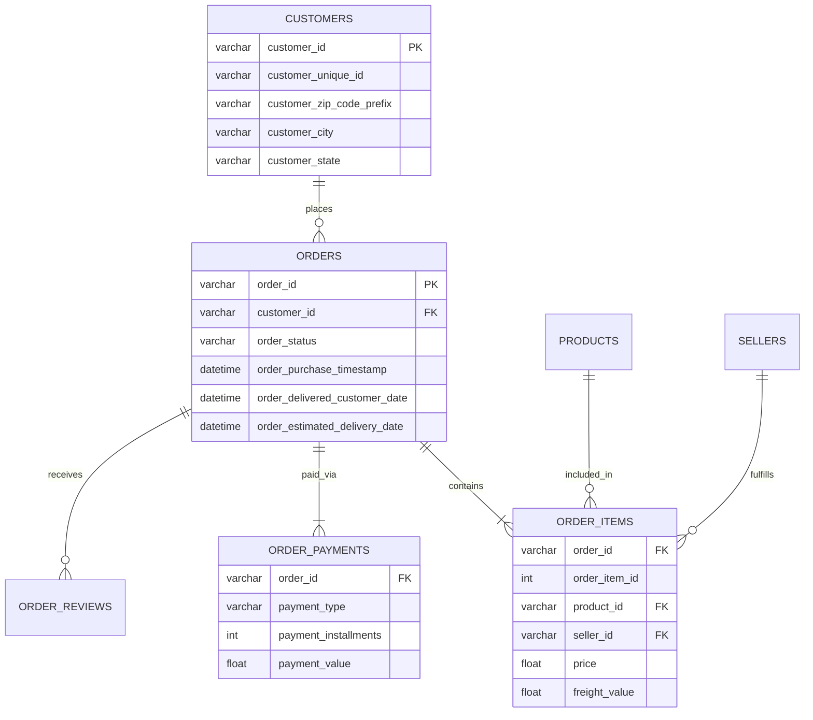

# 📊 E-Commerce Business Analysis Report

## 1. Executive Summary
This report analyzes over 100,000 orders from the Olist Brazilian E-Commerce dataset. By leveraging advanced SQL querying techniques across normalized data tables, we have extracted key insights into revenue generation, customer purchasing behaviors, supply chain bottlenecks, and payment preferences. These insights are designed to guide strategic decision-making to optimize logistics, improve customer retention, and maximize platform profitability.

## 2. Entity-Relationship (ER) Diagram
*The following diagram maps the relational database schema implemented in SQL Server.*

## 3. Key Findings & Insights

### 💰 Sales & Revenue
*   **Category Dominance:** The `health_beauty` and `watches_gifts` categories are the most lucrative segments. These categories combined generate over $2.4M in gross revenue, signifying a strong market for lifestyle and personal care goods.
*   **Growth Spikes:** The platform saw massive month-over-month growth peaks in early 2017 (over 100% MoM), requiring aggressive seller onboarding to maintain supply.

### 🚚 Logistics & Supply Chain
*   **Delivery Expectations:** While the vast majority of orders arrive on time, roughly 7-9% of deliveries miss their estimated delivery dates.
*   **Impact on Satisfaction:** Correlation analysis reveals that **late deliveries heavily impact customer review scores**, drastically increasing the likelihood of 1-star ratings. Resolving last-mile logistics in delayed states (like RR and AL) is critical for brand reputation.

### 💳 Payment Preferences
*   **Credit Overwhelmingly Preferred:** Credit cards account for roughly 74% of all transaction volume. 
*   **Installment Reliance:** Brazilian consumers heavily utilize credit card installments (Boleto/Parcelamento) for higher-value items. Optimizing the checkout flow to clearly display installment options is essential for conversion rate optimization (CRO).

## 4. Strategic Recommendations
1.  **Introduce Carrier Service Level Agreements (SLAs):** Implement financial penalties for logistics partners who consistently miss delivery windows, as these delays are directly causing negative product reviews.
2.  **Launch a VIP Loyalty Program:** A small percentage of `customer_unique_id`s generate disproportionately high order volumes. A targeted email marketing campaign with exclusive vouchers for repeat buyers will increase Customer Lifetime Value (LTV).
3.  **Quality Control Flags:** Products generating high revenue but maintaining average review scores below 2.5 stars should be temporarily delisted and investigated to reduce refund rates.
